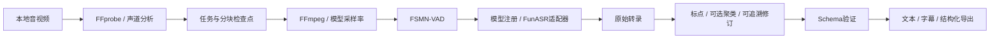

# Local Media Transcriber

**本地音视频智能转录工具**：把本地音频和视频转换为可检索、可编辑、可分析的结构化文本。CPU 优先，使用 FunASR；不上传录音或逐字稿，不依赖付费云端 API。

[English](README_EN.md) · [测试与限制](docs/tests-report.md) · [第三方许可](THIRD_PARTY_NOTICES.md) · [隐私](docs/privacy.md)

项目代码及 Skill 使用 MIT。模型权重有各自许可，尤其 SenseVoiceSmall 使用自定义模型协议；“免费本地运行”不代表所有权重都按 MIT 发布。

## 可以做什么

| 用途 | 典型材料 | 建议模式 |
|---|---|---|
| 会议与商务 | 商务会议、项目讨论、远程会议、汇报、客户沟通、导师讨论、答辩录音 | `diarization` 或 `research` |
| 教育与知识学习 | 大学课、网课、讲座、培训、学术报告、教材音频、托福/雅思材料 | `transcription` 或 `learning` |
| 内容创作 | 播客、已合法取得的 YouTube 视频、短视频、纪录片、访谈、直播录屏 | `subtitle` 或 `diarization` |
| 调研与研究 | 用户/专家访谈、市场调研、田野调查、实验录音、焦点小组 | `research` |
| 个人记录 | 备忘录、口述笔记、灵感、日记、语音草稿、合法授权的电话录音 | `transcription` |
| 无障碍与归档 | 视频字幕、音频字幕、内容提取、文字检索、时间戳定位、音视频归档 | `subtitle` 或 `batch` |

转录、翻译、摘要和业务分析相互独立。核心不会把会议纪要当逐字稿，也不会自动调用外部 LLM。识别结果仍需人工校对。

## 安装

首发验证环境是 macOS / Apple Silicon / 32GB RAM / Python 3.11 / CPU；实际验证范围见测试报告。源码尽量兼容 Intel Mac、Linux 和 Windows 11，但未实测的平台不会标成已验证。

```bash
git clone https://github.com/yesaze2077/local-media-transcriber.git
cd local-media-transcriber
bash install.sh
source .venv/bin/activate
transcribe doctor
```

安装脚本检查架构、准备独立 Python 3.11 `.venv`、检查 FFmpeg、按 `uv.lock` 安装依赖、下载默认 Paraformer/FSMN-VAD/CT-Punc、导入 FunASR 并运行真实 CPU 冒烟测试，最后链接 Skill。已有 `uv` 会直接使用；缺少 `uv` 时用独立缓存虚拟环境引导安装。macOS 已有 Homebrew 时可安装缺失的 FFmpeg；其他系统请先通过系统包管理器安装 FFmpeg/FFprobe。不会向系统 Python 安装项目包。

本版的完整 ASR 安装必须使用仓库内 `install.sh` 或上述 `uv sync --frozen` 流程。`[tool.uv] exclude-dependencies` 明确排除仅有 NTT 评估许可的 `kaldiio`；FunASR 导入前会装入本项目独立编写的禁用适配器。该适配器只满足未使用模块的导入要求，所有 Kaldi archive 读取/写入入口均立即报错；它没有复制 `kaldiio` 源码，也没有实现 archive 兼容。当前支持普通音视频文件，不支持 `.ark` / `.scp` 输入。

不要使用 `pip install .[asr]` 作为完整安装：pip 不执行 uv 的依赖排除，会重新安装 `kaldiio`，本程序也会拒绝使用检测到该库的环境。发布 wheel 只用于基础 CLI 分发，不代表包含完整且已配置的 ASR 运行环境。详见[依赖许可说明](THIRD_PARTY_NOTICES.md)。

已有模型且无需重复冒烟时可用 `bash install.sh --skip-models --skip-smoke`。默认完整安装需要联网下载 Python、依赖和模型；之后 `run` / `batch` 使用本地缓存。SenseVoiceSmall 和 CAM++ 按需下载：

```bash
transcribe models list
transcribe models download sensevoice-small
transcribe models download cam++
```

权重默认从模型发布方的 ModelScope 官方镜像分块下载、支持断点恢复，使用注册表中固定 Hugging Face revision 的 LFS SHA256 校验完整权重；配置/词表等小文件仍取固定 revision 的 Hugging Face 仓库。镜像只提供字节传输，不改变模型身份或许可。权重哈希不匹配时拒绝激活；可用 `LMT_WEIGHT_SOURCE=hf transcribe models download paraformer-zh` 让权重也直接走 Hugging Face。下载命令可能同时联系 ModelScope 和 Hugging Face，媒体与逐字稿不会上传。

Windows 手动安装（PowerShell，先安装 uv 和 FFmpeg）：

```powershell
uv python install 3.11
uv sync --frozen --python 3.11 --extra asr --extra docx --extra dev
.\.venv\Scripts\transcribe.exe setup --download
.\.venv\Scripts\transcribe.exe doctor
```

Windows Skill 安装可将仓库内 `.agents/skills/local-media-transcription` 链接到用户的 `~/.agents/skills/`，或使用 Codex Skill 安装器；遇到已有目录先检查，不能直接覆盖。Windows 的物理设备推理仍需自行验证。

## 快速开始

```bash
transcribe --version
transcribe run input/audio.m4a --language zh --formats txt,json --output output
transcribe run input/video.mp4 --mode subtitle --formats txt,srt,vtt,json
transcribe run input/interview.wav --mode diarization --speakers 2
transcribe run input/lecture.mp4 --mode learning --language en
transcribe run input/interview.wav --mode research --formats txt,json,csv,md,docx
transcribe run input/audio.wav --language auto --no-diarization
transcribe batch input --recursive --formats txt,srt,json,csv
transcribe cache info
```

`transcribe --help` 及各子命令 `--help` 是当前安装版本的参数依据。默认 CPU，`--threads` 控制线程；`--chunk-seconds` 控制分块上限。大文件按块处理，首次加载模型会占用时间和内存。不承诺未经测量的实时倍速或准确率。

## 模式与模型

| 模式 | 输出重点 | 说话人 |
|---|---|---|
| `transcription` | 原文及可用时间戳 | 不强制聚类 |
| `diarization` | 逐段原文、时间戳、匿名编号及统计 | CAM++ 可选，支持指定人数 |
| `subtitle` | SRT/VTT、带时间的 TXT | 按配置启用 |
| `learning` | 句段及音频位置映射、原文/译文关联字段 | 按配置启用 |
| `research` | 逐字稿、段落和定性分析所需 JSON/CSV | 匿名编号可人工映射 |
| `batch` 子命令 | 多文件、逐文件状态与结果 | 可按文件配置 |

| 注册模型 | 能力 | 语言 / 采样率 | 限制 |
|---|---|---|---|
| `paraformer-zh` | 中文 ASR、对齐时间戳 | 普通话，适用中英混合 / 16kHz | 不用于宣称所有语言准确识别 |
| `sensevoice-small` | 多语言 ASR 与语言标签 | 中、英、粤、日、韩 / 16kHz | 时间戳依赖 VAD 段边界，精度不同于字级对齐 |
| `fsmn-vad` | 语音活动检测 | 中英文场景 / 16kHz | 静音/噪声判断可能出错 |
| `ct-punc` | 标点恢复 | 中、英 / 文本输入 | 仅在适用语言启用 |
| `cam++` | 声纹向量与聚类组件 | 16kHz | 匿名声纹不等于真实身份；不负责重叠语音源分离 |

显式 `--language zh` 使用中文路径；`--language auto` 或英语/其他支持语言选择多语言路径。`--model` 可覆盖自动选择，但必须匹配模型能力。注册表独立记录 ID、用途、语言、设备、采样率、下载源、revision、许可和缓存信息；扩展模型还需实现适配器并实测。

## 媒体、声道与字幕时间

音频输入：WAV、MP3、M4A、AAC、FLAC、OGG、OPUS、WMA（本机 FFmpeg 支持时）。视频输入：MP4、MOV、MKV、WEBM、AVI、M4V。保留源媒体，FFprobe 提取时长/流信息；FFmpeg 输出与模型要求匹配的 PCM。当前注册音频模型均为 16kHz，但采样率来自注册配置。

先检查原始声道信息，再决定混音。默认分别处理声道；`--channel mix` 显式混合，`--channel 0` / `1` 选择零起始声道，`--channel split` 分别处理并保留声道标记。独立麦克风不应在未检查时直接合并。声道编号也不保证人物身份。

字幕保持原文件的时间基准，分块结果加回原始偏移。时间缺失时保留未知值；SRT/VTT 不会按字数伪造时间，缺少可用时间的非空片段会明确报错。识别分段并非专业字幕排版，可按需要再人工调整换行和阅读速度。

## 可追溯后处理与结构化输出

TXT、SRT、VTT、JSON、CSV、Markdown 和 DOCX。DOCX 需要安装 `docx` extra（完整安装脚本已包含）。JSON 经过仓库内 JSON Schema 校验，主要包含：

```json
{
  "metadata": {
    "source_file": "source.mp4",
    "duration_ms": 12000,
    "language": "zh",
    "model": "paraformer-zh"
  },
  "speakers": [],
  "segments": [
    {"id": 1, "start_ms": 100, "end_ms": 1500, "speaker_id": null, "text": "示例结构"}
  ],
  "raw_transcript": {"segments": [], "model_results": []},
  "processed_transcript": {
    "segments": [
      {"id": 1, "start_ms": 100, "end_ms": 1500, "speaker_id": null, "text": "示例结构"}
    ]
  },
  "changes": [],
  "warnings": []
}
```

以上只是字段示例，不是实际转录。未知时间和未知说话人允许 `null`。默认保留重复、停顿、语气词和不完整句；模型本身可能省略口语细节，因此“逐字稿”不等于人工听写真值。`--glossary` 可加载经审核的术语/人名替换 JSON；`--speaker-map` 使用实际输出编号做人工身份映射。只有明确选择 `--reading` 才启用口语清理。原始结果、处理结果和修改日志分别保留。

`--time-offset-ms` 可做带记录的整体时间偏移；它不推算缺失的对齐信息。学习模式可用 `--exercises` 导出本地练习材料。翻译关联字段用于后续对接；核心不自带翻译模型、不生成语义摘要。学习材料不能直接作为未经核对的听写标准答案。句级精细时间只在模型提供对齐时输出；其他情况保留 VAD 区间时间并标注精度，不按文字猜测精细时间。

## 任务、恢复与批量

任务使用媒体内容和有效参数生成稳定标识，记录状态、进度、分块检查点、失败和输出摘要。中断后重复相同命令可恢复；失败任务需追加 `--retry`；完成后验证结果完整性再复用，已有结果不会静默覆盖。改变模型、语言或处理参数会产生不同任务。源文件永不自动删除。

批量可以递归发现支持格式。单个文件失败会保留其任务状态，其他文件继续；整体失败不能被报告为全部成功。逐文件配置使用 `--manifest` JSON，键为相对输入目录的文件路径，值为参数对象，参数名使用 `snake_case`。例如：

```json
{
  "lecture.mp4": {"mode": "learning", "language": "en", "exercises": true},
  "interviews/session.wav": {"mode": "research", "language": "zh", "speakers": 2}
}
```

运行 `transcribe batch input --recursive --manifest batch.json`。所有配置在开始前统一校验。可覆盖 `mode`、`language`、`model`、`speakers`、`no_diarization`、`formats`、`channel`、`glossary`、`speaker_map`、`reading`、`chunk_seconds`、`threads`、`time_offset_ms` 和 `exercises`。

本地 state 持久保留原始逐字稿；启用 CAM++ 时还会在分块检查点保留声纹向量，均属敏感数据，须在私有目录按录音同等隐私级别管理。只有事件日志脱敏。当前只自动清理程序自身临时媒体，不提供自动删除 state 的命令；确认路径和保留需要后，可自行清理应用缓存/状态，这会失去断点或需要重新下载模型。日志应只记录运行信息，输出完整路径可能出现在用户主动运行的 CLI 结果中，不应复制到公开 issue。

## Codex Skill

Skill 源码位于 `.agents/skills/local-media-transcription/`。完整安装优先创建 `~/.agents/skills/local-media-transcription` → 仓库目录的符号链接；若已有不同链接或目录，安装停止并保留原内容。

可用“转录这个音频”“提取视频字幕”“区分两位说话人”“批量转录”“提取课程/访谈逐字稿”“做语言学习材料”“整理口述笔记”等请求触发。Skill 优先调用已安装 CLI，先检查环境、缓存与格式，再选择模式/模型。安装后通过 `scripts/verify_skill.py` 调用本地 `codex app-server` 的只读 `skills/list`，强制刷新并从临时目录核验目标 Skill 已启用、作用域为 user、路径匹配仓库；缺少 Codex 时明确输出 `unverified`，Codex 存在但未发现时安装返回失败，不创建聊天或调用模型。

## 架构、验证与限制



[架构及扩展边界](docs/architecture.md) · [测试报告](docs/tests-report.md) · [依赖和权重许可](THIRD_PARTY_NOTICES.md)

```bash
make test
make lint
make build
make smoke
```

测试报告分开列出真实 ASR 推理、软件功能测试、仅完成代码的路径、未支持能力和兼容性风险。合成语音能证明流程可执行，不能代替真实多人访谈准确率评估。重叠发言、强噪声、远场、方言和跨块聚类都需人工复核。CAM++使用1.5秒语音窗、0.75秒步长做全局聚类，再按时间重叠映射到句子；混合标签的句子标记speaker_uncertain。短时换人和重叠发言仍可能误判，自动人数使用启发式阈值；每任务最多5000个声纹窗口，超限需拆分任务或关闭聚类。没有准确率基准时不提供准确率承诺。

本轮实测：75项软件测试与19项集成执行场景通过；自动人数在双声线样本上估为4簇，属于实验功能，已知人数时建议显式指定。详见[测试报告](docs/tests-report.md)。

## 常见问题

**离线为什么提示缺模型？** 首次运行 `setup --download`，按需下载多语言/声纹模型，再运行相同命令。下载失败不会产生成功转录。

**缓存在哪里？** macOS 默认 `~/Library/Caches/local-media-transcriber/models/`；任务位于 `~/Library/Application Support/local-media-transcriber/jobs/`。可用 `LMT_CACHE_DIR` / `LMT_STATE_DIR` 指向其他目录。`cache info` 显示本机实际路径。

**磁盘不够或任务很长？** 预留依赖、权重、检查点和结果空间，调整分块与线程数。只删除程序自身缓存/临时文件；不要批量删除输入媒体。32GB 内存不是所有长度/模型组合都已验证的保证。

**能自动辨认谁是谁吗？** 当前给匿名簇或声道编号；人物名字由用户核对后映射。指定人数是聚类约束，不是真实身份验证或人数真值。

**能直接下载在线平台视频吗？** 本版本处理已经合法取得的本地文件，不包含平台抓取/下载流程。

**能写会议总结或翻译吗？** 使用结构化文本交给独立后处理模块。外部 API 只有用户明确授权后才能调用。

后续可扩展其他模型、专门重叠语音模块、人工校对界面、独立本地翻译/内容理解和更广平台实测；这些能力不属于当前已验证结果。
