# Local Media Transcriber

Local-first audio/video transcription with modular FunASR models, timestamped text, optional anonymous speaker clustering, subtitles and resumable batch jobs. CPU is the default. Media and transcripts are not uploaded; no paid cloud API is required.

[中文](README.md) · [Verification report](docs/tests-report.md) · [Third-party licenses](THIRD_PARTY_NOTICES.md) · [Privacy](docs/privacy.md)

Project code and the Codex Skill are MIT. Model weights have separate licenses, including the custom agreement for SenseVoiceSmall; the MIT license does not cover every checkpoint.

## Use cases

- Business: meetings, project discussions, remote calls, reports, customer conversations, thesis supervision and defense recordings.
- Education: classes, online courses, lectures, training, academic talks, textbook audio and TOEFL/IELTS study material.
- Content: podcasts, lawfully obtained local YouTube videos, short videos, documentaries, interviews and livestream recordings.
- Research: user/expert interviews, market research, fieldwork, experiments and focus groups.
- Personal: voice memos, dictation, ideas, diaries, drafts and lawfully authorized call recordings.
- Accessibility and archiving: video/audio subtitles, content extraction, text search and timestamp navigation.

Transcription, translation, summaries and business analysis stay independent. The core does not call an external LLM or substitute minutes for a verbatim transcript. ASR is fallible and needs review where exact wording matters.

## Install

The initial target is macOS, Apple Silicon, 32GB RAM, Python 3.11 and CPU. See the test report for actual measurements. Intel Mac, Linux and Windows compatibility is intended; physical-device inference is only claimed when tested.

```bash
git clone https://github.com/yesaze2077/local-media-transcriber.git
cd local-media-transcriber
bash install.sh
source .venv/bin/activate
transcribe doctor
```

The installer prepares Python 3.11 in `.venv`, checks FFmpeg/FFprobe, installs frozen dependencies, imports FunASR, downloads default Paraformer/FSMN-VAD/CT-Punc weights, runs a real CPU smoke test, and safely symlinks the Skill. It reuses installed uv or bootstraps uv in an isolated app cache. On macOS with Homebrew it can install missing FFmpeg; otherwise install FFmpeg through the OS package manager first. No project packages are installed into system Python.

For full ASR, use this checkout's `install.sh` or `uv sync --frozen` workflow. The uv `exclude-dependencies` setting excludes `kaldiio`, whose published license is an NTT evaluation agreement. Before FunASR imports, an original project adapter explicitly disables unused Kaldi archive operations. It contains no copied `kaldiio` source, implements no archive reader/writer, and raises immediately if an archive entry point is called. `.ark` / `.scp` inputs are unsupported.

Do not use `pip install .[asr]` as a complete installation: pip does not apply uv's exclusion and would install `kaldiio`; the application rejects a runtime where that package is present. The release wheel distributes the basic CLI, not a complete configured ASR environment. See [dependency license details](THIRD_PARTY_NOTICES.md).

For an existing provisioned installation, `bash install.sh --skip-models --skip-smoke` avoids downloads and inference. The initial Python/package/model downloads need internet; normal inference uses cached local weights offline. Download multilingual or speaker models as needed:

```bash
transcribe models list
transcribe models download sensevoice-small
transcribe models download cam++
```

Weights default to resumable byte-range downloads from the model publisher's official ModelScope mirror. Their complete SHA256 must match the LFS hash from the registry's pinned Hugging Face revision; configuration/vocabulary files still come from that pinned Hugging Face snapshot. A mirror changes transport, not model identity or licensing. A mismatch prevents activation. Use `LMT_WEIGHT_SOURCE=hf transcribe models download paraformer-zh` for direct Hugging Face weight downloads. Downloads may contact both hosts; media and transcript contents are not sent.

Windows manual setup, after installing uv and FFmpeg:

```powershell
uv python install 3.11
uv sync --frozen --python 3.11 --extra asr --extra docx --extra dev
.\.venv\Scripts\transcribe.exe setup --download
.\.venv\Scripts\transcribe.exe doctor
```

Link the repository Skill into `~/.agents/skills/`, preserving any existing directory, or install it through a Codex Skill installer. The Bash installer targets macOS/Linux; Windows manual setup still requires platform testing.

## CLI

```bash
transcribe --version
transcribe doctor
transcribe setup --download
transcribe models
transcribe models list
transcribe cache info
transcribe run input/audio.m4a --language zh --formats txt,json --output output
transcribe run input/video.mp4 --mode subtitle --formats txt,srt,vtt,json
transcribe run input/audio.wav --mode diarization --speakers 2
transcribe run input/lecture.mp4 --mode learning --language en --exercises
transcribe run input/interview.wav --mode research --formats txt,json,csv,md,docx
transcribe run input/audio.wav --language auto --no-diarization
transcribe batch input --recursive --formats txt,srt,json,csv
```

Use the installed command's `--help` for its authoritative options. `--threads` bounds CPU threads and `--chunk-seconds` controls bounded audio chunks. Normal output defaults to TXT/JSON; subtitle mode also includes SRT/VTT/TXT. `--offline` expresses the default: `run`/`batch` never download missing models. There is no unmeasured accuracy or realtime-speed guarantee.

| Mode | Main output |
|---|---|
| `transcription` | Original recognized wording and available timestamps; no mandatory speaker clustering |
| `diarization` | Timestamped segments, anonymous speaker IDs and statistics; optional known count |
| `subtitle` | SRT/VTT and timestamped TXT on the source timeline |
| `learning` | Sentence/segment-to-audio mapping, separate translation linkage fields and optional local practice exports |
| `research` | Verbatim-oriented paragraphs, speaker IDs and JSON/CSV for qualitative analysis |
| `batch` command | Folder discovery, independent status, recovery and per-file settings |

A mapping from voices to real names must be reviewed by a person. Use `--speaker-map` with IDs actually emitted in the output. A requested count constrains clustering; it does not establish the real number of people. CAM++ is an embedding component, not a universal overlapping-speech separation model.

## Models

| Registry name | Role | Languages / input rate |
|---|---|---|
| `paraformer-zh` | Mandarin ASR and alignment | Mandarin, applicable Chinese/English mixed speech / 16kHz |
| `sensevoice-small` | Multilingual ASR and language tags | Mandarin, English, Cantonese, Japanese, Korean / 16kHz |
| `fsmn-vad` | Speech activity detection | Chinese/English scenarios / 16kHz |
| `ct-punc` | Punctuation restoration | Chinese/English text |
| `cam++` | Speaker embeddings for clustering | 16kHz audio |

Explicit `--language zh` chooses the Chinese path. `auto`, English and other supported languages use the multilingual path. `--model` overrides selection only within the checkpoint's capabilities. Paraformer is not presented as an accurate all-language recognizer. SenseVoice VAD segment timing is coarser than aligned character/word timing. Checkpoint revisions, publisher URLs, licenses, sample rates, languages, devices and cache locations live in the registry rather than transcription business logic. Adding a row is insufficient: a new model also needs an adapter and real validation.

## Media and channels

Audio: WAV, MP3, M4A, AAC, FLAC, OGG, OPUS and WMA when the local FFmpeg build supports it. Video: MP4, MOV, MKV, WEBM, AVI and M4V. Input files remain unchanged. FFprobe records duration and stream information; FFmpeg extracts bounded PCM chunks at the model's configured rate. Current audio checkpoints use 16kHz; the architecture does not hardcode that rate for every future model.

Stereo defaults to separate channel handling so microphone information is retained. `--channel mix` explicitly mixes channels, `--channel 0` or `1` selects a zero-based channel, and `--channel split` processes channels separately. Inspect channel analysis before choosing. Channels are recording channels, not guaranteed person identities.

Source offsets are added to chunk timestamps. Unknown times stay null. A nonempty segment without usable times cannot be exported as a fabricated SRT/VTT cue. Subtitles may need editorial line breaks and reading-speed adjustments.

## Structured exports and local postprocessing

TXT, SRT, VTT, JSON, CSV, Markdown and optional DOCX are supported. The full installer includes the `docx` extra. JSON is validated with the bundled JSON Schema and includes metadata (`source_file`, `duration_ms`, `language`, `model`), speakers, segments (`id`, nullable `start_ms`/`end_ms`, nullable `speaker_id`, `text`), raw/processed transcripts, change records and warnings.

Defaults preserve repetitions, fillers and incomplete sentences to the extent the model emits them. `--glossary` loads a reviewed JSON object of source strings to replacements, including names/terms. `--reading` enables local oral-language cleanup only when explicitly requested. `--time-offset-ms` applies an audited offset, not audio/text alignment inferred from character counts. Raw model output remains separate from corrections.

Learning mode contains original/translation linkage fields, not a bundled translation engine. `--exercises` can export local practice material; recognized text is not a verified dictation answer key. Fine sentence timing is exported only when supplied by alignment; otherwise VAD intervals retain an explicit coarser precision. Semantic summaries, interpretation, local translation models and external APIs belong in separate consumers.

## Jobs, resume and batches

Jobs identify source content and effective settings, record progress and chunk checkpoints, and validate output integrity before reuse. Repeat the same command after an interruption to resume. Failed jobs require `--retry`. New effective settings produce a different job. Existing results are not silently overwritten; sources are never automatically deleted.

For per-file overrides:

```json
{
  "lecture.mp4": {"mode": "learning", "language": "en", "exercises": true},
  "interviews/session.wav": {"mode": "research", "language": "zh", "speakers": 2}
}
```

```bash
transcribe batch input --recursive --manifest batch.json
```

Manifest keys are paths relative to the input directory. Override fields use snake_case, for example `no_diarization`, `speaker_map`, `chunk_seconds`, `time_offset_ms`. All entries are validated before processing starts. Individual failures preserve state while other files continue; batch failure must not be represented as complete success.

## Skill

The source is `.agents/skills/local-media-transcription/`. The installer links it to `~/.agents/skills/local-media-transcription/`, refusing to overwrite a different link or existing directory. After linking, `scripts/verify_skill.py` calls the local `codex app-server` read-only `skills/list`, forces a refresh, and verifies the enabled user-scope Skill and its checkout path from a temporary cwd. Missing Codex is explicitly `unverified`; an available Codex that does not discover the Skill causes installation failure. No chat or model call is created.

The Skill routes transcription, subtitles, speaker labeling, folder batches, lectures, interviews, learning material and oral notes to the installed CLI. It checks environment, cached models and source format first, and reports input, duration, model/revision, language, speaker status, formats, outputs and uncertainty. It does not rewrite a Python transcriber on each invocation.

## Architecture and validation

```mermaid
flowchart LR
    Media[Local media] --> Probe[FFprobe / channel analysis]
    Probe --> Jobs[Tasks and checkpoints]
    Jobs --> PCM[FFmpeg / model sample rate]
    PCM --> VAD[FSMN-VAD]
    VAD --> ASR[Registry / FunASR adapter]
    ASR --> Raw[Raw transcript]
    Raw --> Process[Punctuation / optional clustering / audited corrections]
    Process --> Schema[Schema validation]
    Schema --> Export[Text / subtitles / structured exports]
```



[Architecture](docs/architecture.md) · [Verification report](docs/tests-report.md) · [Licenses](THIRD_PARTY_NOTICES.md)

```bash
make test
make lint
make build
make smoke
```

The report separates real inference, software tests, implementation-only paths, unsupported features and known risks. Synthetic speech demonstrates execution, not accuracy on real interviews or independent human speakers. Overlap, noise, distance, dialects and cross-chunk clustering require review. CAM++ uses 1.5-second windows with a 0.75-second hop, global clustering and temporal sentence assignment. Conflicting sentence labels are marked `speaker_uncertain`; short turns and overlap remain uncertain. Automatic counts use a heuristic threshold. A job supports up to 5000 speaker windows; split larger jobs or disable diarization. Tests do not establish a general accuracy benchmark.

## FAQ and privacy

**Missing cache while offline?** Run `setup --download` and download optional models first, then retry offline. A failed download is not a successful transcript.

**Storage?** macOS defaults are `~/Library/Caches/local-media-transcriber/models/` for models and `~/Library/Application Support/local-media-transcriber/jobs/` for jobs. `LMT_CACHE_DIR` and `LMT_STATE_DIR` override them. `cache info` prints the actual locations. `.venv` stays in the checkout, and outputs use the selected output directory.

**Long media or low disk space?** Reserve space for dependencies, weights, checkpoints and exports. Tune threads/chunk length. Only remove app-owned temporary/cache files; never batch-delete original media. 32GB RAM is not a guarantee for every model/input combination.

**Online video download?** This version accepts lawfully obtained local files; platform downloaders are outside its scope.

**Network and personal data?** Normal inference sends no media or transcript. Downloads contact package/model hosts. Persistent state contains raw transcripts and, with CAM++, speaker embedding vectors in chunk checkpoints; protect these sensitive local data like the recordings in a private directory. Only operational event logs are redacted. This version automatically removes only app-owned temporary media and provides no automatic state-deletion command. You may deliberately clean app-owned cache/state after checking the path and retention needs; resume data is then lost and models may need redownloading. Do not commit private fixtures, caches, environments, model weights or secrets. See [privacy details](docs/privacy.md).

Future extensions may add new checkpoint adapters, dedicated overlap processing, review UI, independent local translation/understanding and broader platform tests. These are not claimed as current validated capabilities.

Validation: 75 software tests and 19 integration execution scenarios passed. Automatic count estimation produced 4 clusters for a two-voice synthetic sample; it is experimental. Specify a known speaker count and review labels. See the [test report](docs/tests-report.md).
