# Architecture and extension boundaries

```mermaid
flowchart LR
    Input[Local media / batch manifest] --> Probe[FFprobe metadata and channels]
    Probe --> Jobs[Task identity, checkpoints and resume]
    Jobs --> FFmpeg[Bounded PCM chunks at model sample rate]
    FFmpeg --> VAD[FSMN-VAD speech intervals]
    VAD --> ASR[Registered local ASR adapter]
    ASR --> Raw[Raw model output / raw transcript]
    Raw --> Punc[Optional CT-Punc]
    Raw --> Speaker[Optional CAM++ embeddings and clustering]
    Punc --> Process[Audited local corrections]
    Speaker --> Process
    Process --> Schema[JSON Schema and time checks]
    Schema --> Export[TXT / SRT / VTT / JSON / CSV / MD / DOCX]
```

The diagram describes responsibilities, not a promise that every model natively returns every field. VAD timing identifies detected speech intervals. Paraformer alignment and SenseVoice segment timing have different precision. Anonymous speaker IDs originate in clustering; mapping them to names requires review. Independent channels can preserve microphone information and help investigation, but channel separation is not source separation of overlapping voices.

Models are configured in the registry, independently of CLI/business modes. Each entry includes purpose, languages, device, sample rate, source, revision, license and cache path. An adapter normalizes framework output into nullable timing and speaker fields. New checkpoints require capability/format/permission review and representative real inference tests. Do not declare support by adding a registry row alone.

Raw results, processed results and modification records remain distinct. Term substitution, optional oral-language cleanup and offsets are deterministic local postprocessing. Translation, summaries, qualitative coding and richer learning exercises belong in independent consumers of the structured export. The core does not call an external LLM.

Chunk checkpoints bound ASR working memory and provide restart points. Files with the same content and effective options can share a task result; output integrity is checked before reuse. Diarization across chunk boundaries must be treated cautiously: speaker IDs must be globally clustered or explicitly scoped rather than silently treating per-chunk numbers as the same person. See the test report for the implemented path and observed limits.

## Audio-only FunASR import boundary

Full runtime installation uses the repository's frozen uv workflow. `[tool.uv] exclude-dependencies = ["kaldiio"]` omits the upstream evaluation-licensed package; pip does not honor this uv setting. `core/compat.py` is independently written MIT code that binds the unused module import to explicit unsupported-operation handlers before FunASR loads. It neither vendors `kaldiio` source nor replaces its archive implementation. Existing real `kaldiio` installations cause a clear error rather than silently shadowing them. Kaldi `.ark` / `.scp` inputs are outside this release; ordinary NumPy audio inputs do not call the disabled archive functions. The published wheel is a base CLI artifact, while the source checkout and uv lock define the full ASR environment.

## Model download identity

The default downloader obtains large weights in resumable ranges from the publishers' official ModelScope mirrors and validates the complete file against the fixed Hugging Face revision's LFS SHA256 recorded in the registry. Configuration/vocabulary files come from the pinned Hugging Face snapshot. Each resumed range is also checked before reuse; a complete weight mismatch refuses activation. `LMT_WEIGHT_SOURCE=hf` selects direct Hugging Face weight transport. Model identity, licenses and offline inference behavior remain independent of which download host transports the bytes.
